직접 하던 일을 최근에는 일부러 Claude Code나 Codex 같은 에이전트에게 맡겨 보고 있습니다. 에이전트를 사용하는 것도 연습이 필요하다고 느껴졌기 때문입니다.

모델의 성능이 좋아지고 있다는 건 틀림없습니다. 그런데 에이전트를 쓰다 보면 어떤 때는 기대를 뛰어넘는 결과물을 내놓고, 어떤 때는 기대에 못 미치는 결과물을 돌려줍니다.

그래서 궁금해졌습니다. 어떻게 하면 늘 좋은 결과물을 받을 수 있을까? 내가 기대한 만큼의 결과를 얻으려면 어떻게 해야 할까? 결과물을 어떻게 더 잘 제어할 수 있을까?

이 질문을 풀려고 LLM과 그것을 감싼 harness가 어떻게 동작하는지 정리했습니다.

## 들어가며

에이전트의 결과물 품질은 모델 성능만큼 입력 설계에 좌우됩니다. 이 문서는 먼저 에이전트가 어떻게 동작하는지 설명하고, 그 동작에서 직접 나오는 다섯 가지 원칙을 정리합니다. **목표, 맥락, 검증, 실행 수단, 묻기와 진행의 판단**입니다.

이 글은 에이전트를 두 층으로 나눠 봅니다. 글을 만드는 **LLM**, 그리고 LLM을 루프로 돌리며 도구를 실행하고 컨텍스트를 관리하는 **harness**입니다. 두 층은 할 수 있는 일과 한계가 다르기 때문에, 1부에서 LLM을, 2부에서 harness를 나눠 설명합니다.

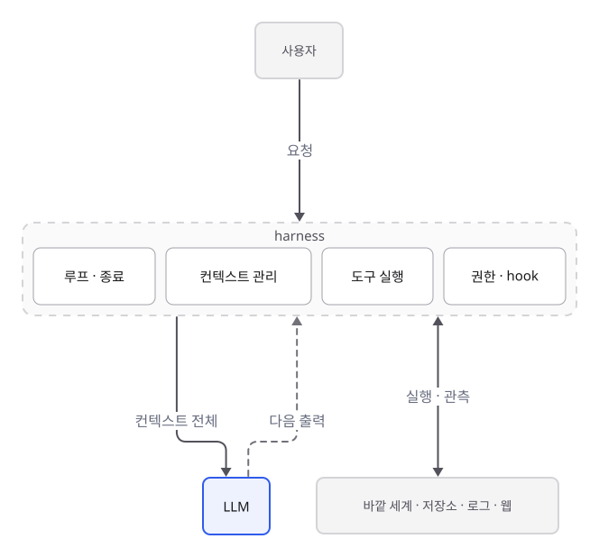

원칙을 외우는 것보다 원리를 이해하는 편이 오래 갑니다. 원리는 모델이 바뀌어도 유지되지만, 구체적인 요령은 모델이 좋아지면서 낡기도 합니다. 원리를 알면 어떤 요령이 아직 유효한지 스스로 판단할 수 있습니다.

## 1부. LLM은 어떻게 동작하나

### 다음 토큰을 하나씩 뽑는다

LLM은 텍스트를 토큰 열로 바꾸고, 그 열의 확률을 다음처럼 쪼개서 모델링합니다.

```latex
p_\theta(x_1, \dots, x_T) = \prod_{t=1}^{T} p_\theta(x_t \mid x_1, \dots, x_{t-1})
```

- \(x_1, \dots, x_T\): 텍스트를 바꾼 토큰 열. 토큰은 모두 \(T\)개입니다
- \(\theta\): 모델의 weight(parameter)
- \(p_\theta(x_t \mid x_1, \dots, x_{t-1})\): 앞의 토큰들이 주어졌을 때 \(t\)번째 토큰이 나올 확률. \(\mid\)는 '~가 주어졌을 때'라는 뜻입니다
- \(\prod_{t=1}^{T}\): \(t=1\)부터 \(T\)까지 모두 곱한다는 뜻
{.symbols}

생성은 이 식을 그대로 따라갑니다. 지금까지의 토큰을 보고 다음 토큰의 분포를 계산해 하나를 뽑고, 그 토큰을 입력 끝에 붙여 다시 넣습니다. 사용자가 준 프롬프트는 이미 주어진 앞부분일 뿐이고, 모델은 그 뒤를 이어 씁니다. 각 단계는 분포에서 하나를 sampling하는 과정이라, 같은 요청에 다른 결과가 나오는 것은 정상입니다. temperature를 낮추면 가장 그럴듯한 토큰 쪽으로 쏠리고, 높이면 다양해집니다.

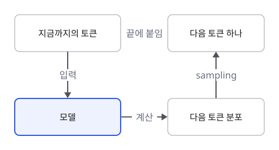

### 지시를 따르고 결과로 평가받도록 학습되었다

pretraining만 한 모델은 인터넷 텍스트의 다음 토큰을 잘 맞히는 모델입니다. 지금 쓰는 모델은 그 위에 학습을 더 거칩니다.

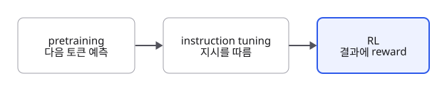

- **Instruction tuning.** (지시, 답) 쌍으로 supervised fine-tuning(SFT)을 합니다. 이 데이터에서 지시는 주로 무엇을 할지와 사람의 선호(어떤 형식으로 보여 줄지 등)를 담고, 문제를 어떻게 풀지는 대개 담지 않습니다. 사람이 쓴 풀이 과정을 따라 하게 하면 지나친 micromanagement가 될 수 있어서, reasoning 능력은 reinforcement learning(RL)으로 기릅니다.
- **Reinforcement learning.** reasoning 모델은 thinking token을 포함한 전체 생성을 하나의 trajectory로 보고 reward를 받습니다. 정답을 확인할 수 있는 과제에서는 최종 답이 맞으면 1, 틀리면 0을 주는 방식(RLVR, Reinforcement Learning with Verifiable Rewards)을 씁니다. "어떻게 생각했는지는 상관없고, 답을 검증할 수 있으면 된다"는 것입니다. 실제 제품용 모델은 정답 여부 외에도 스타일, 지시 준수 같은 기준으로 reward를 받기도 합니다. 정답이 없는 과제에 LLM을 judge로 쓰면 reward hacking의 위험이 있습니다.

그래서 지금의 모델은 **명시된 과제를 따르고, 확인 가능한 결과를 내는 쪽**으로 강하게 길러져 있습니다.

### LLM의 네 가지 성질

1. **상태가 없다.** 모델은 호출과 호출 사이에 아무것도 기억하지 않습니다. 매 호출에서 받은 입력 전체만을 조건으로 다음 토큰을 계산합니다.
2. **사용 중에는 weight가 바뀌지 않는다.** 예시를 넣는 in-context learning도 parameter를 갱신하지 않고, 예시를 문자열로 입력에 넣을 뿐입니다. zero-shot은 과제를 글로 설명하는 것이고, RAG(Retrieval-Augmented Generation)도 문서를 입력에 넣어 줄 뿐입니다. **모델에게 영향을 주는 것은 그 호출의 입력, 즉 컨텍스트뿐입니다.**
3. **attention은 나눠 쓰는 자원이다.** Transformer에서 여러 위치의 정보를 합치는 장치는 attention이고, attention weight는 softmax로 만든 probability vector라서 합이 1입니다. 한 곳에 주의를 더 주면 다른 곳에는 덜 줍니다. 여기에 학습 데이터에 긴 문서가 상대적으로 적다는 점까지 겹쳐, 컨텍스트가 길어질수록 정보를 정확히 활용하는 능력이 서서히 떨어집니다(context rot). 긴 컨텍스트의 중간에 놓인 정보를 특히 잘 놓친다는 실험 결과도 있습니다.
4. **길이에는 비용이 있다.** 표준 attention은 길이 T에 대해 T² 번의 inner product가 필요합니다. 이전 토큰의 key와 value를 KV cache로 저장하면 같은 앞부분의 계산을 재사용할 수 있습니다. prompt caching은 이 재사용을 호출 사이로 넓힌 것이고, 계산만 줄일 뿐 출력은 캐싱하지 않았을 때와 같습니다.

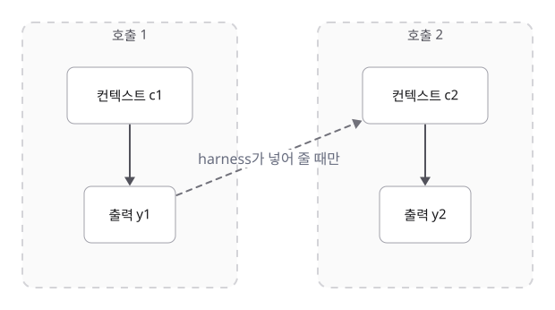

## 2부. 에이전트는 LLM을 어떻게 감싸나

에이전트는 LLM에 harness를 더한 시스템입니다. harness는 모델을 호출하고, 모델이 요청한 도구를 실행하고, 다음 호출에 넣을 컨텍스트를 만들고, 정해진 규칙을 강제합니다. 루프를 돌리는 것도 모델이 아니라 harness입니다.

```
context = [system, user_request]
while True:
    output = model(context)              # 매 호출마다 context 전체가 입력
    if not output.tool_calls:
        return output                    # 도구 호출이 없으면 종료
    results = harness.execute(output.tool_calls)   # 실행은 harness가 함
    context += [output, results]         # 관측이 다음 호출의 조건이 됨
```

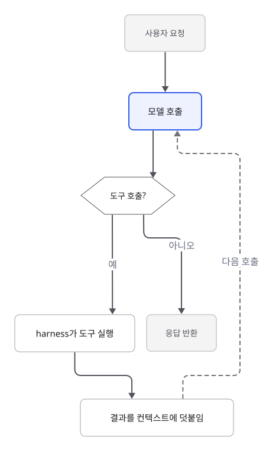

실제 에이전트를 만드는 회사들은 이 루프를 다음처럼 그립니다.



")

**Codex.** 사용자 입력으로 모델이 추론하고, 모델이 도구 호출을 내면 그 결과를 가지고 다시 추론합니다. 도구 호출 없이 응답이 나오면 한 턴이 끝납니다. 모델 추론과 도구 실행이 오가는 구조가 그림의 중심입니다.


")

**Claude Code.** 맥락 수집, 행동, 결과 검증을 반복하고, 사용자는 루프 도중에 끼어들어 방향을 바꾸거나 맥락을 더합니다. 작업의 단계와 사람의 개입이 그림의 중심입니다.



LLM 생성을 MDP(Markov Decision Process)로 보면, state는 프롬프트와 지금까지 생성한 토큰이고 action은 다음 토큰입니다. 에이전트는 여기에 도구 결과라는 observation을 덧붙여, 앞선 결정이 뒤에 파급 효과를 남기는 sequential decision-making 문제를 풉니다.

### harness가 하는 네 가지 일

1. **루프를 돌리고 끝낸다.** 기본 종료 조건은 모델이 도구 호출 없이 답을 내는 것입니다. 그 밖에 최대 턴 수, 비용 한도, 오류로도 끝나고, 반대로 Stop hook처럼 모델이 끝내려 해도 조건을 만족할 때까지 다시 일하게 하는 장치도 있습니다.
2. **도구를 실행한다.** 모델은 tool call을 글로 생성할 뿐이고, 실행은 harness가 합니다. 웹 검색처럼 모델 제공사의 서버에서 실행되는 도구도 있고, 모델이 짠 코드가 여러 도구를 실행한 뒤 결과의 일부만 컨텍스트에 넣는 방식도 있습니다. 어느 쪽이든 **바깥 세계는 컨텍스트에 들어온 관측으로만 모델에 전달됩니다.**
3. **컨텍스트를 관리한다.** 기본적으로 c_{t+1} = c_t ⊕ y_t ⊕ r_t처럼 생성과 도구 결과가 누적됩니다. 하지만 **모델이 받는 컨텍스트는 사용자가 보는 대화와 같지 않습니다.** harness는 CLAUDE.md나 AGENTS.md 같은 파일을 매번 넣고, 오래된 도구 출력을 지우고, 길어지면 compaction을 합니다. compaction 결과는 사람이 읽는 요약일 수도 있고, 제공사에 따라 사람이 읽을 수 없는 암호화 항목일 수도 있습니다. 사용자에게 보이지 않는 이전 턴의 reasoning이 다음 호출로 넘어가기도 하고, 대화 이력을 서버가 보관했다가 붙여 주기도 합니다. 메모리 기능도 저장해 둔 내용을 컨텍스트에 넣는 방식입니다.
4. **규칙을 강제한다.** 에이전트를 조정하는 지시는 두 종류입니다. 프롬프트, CLAUDE.md, skill처럼 **모델이 읽고 판단하는 지시**는 대개 지켜지지만 보장은 없습니다. 권한 설정, deny 규칙, hook, sandbox, effort 설정처럼 **harness가 집행하는 지시**는 모델의 판단과 무관하게 매번 적용됩니다. 반드시 지켜야 하는 규칙은 두 번째 쪽에 두어야 합니다.

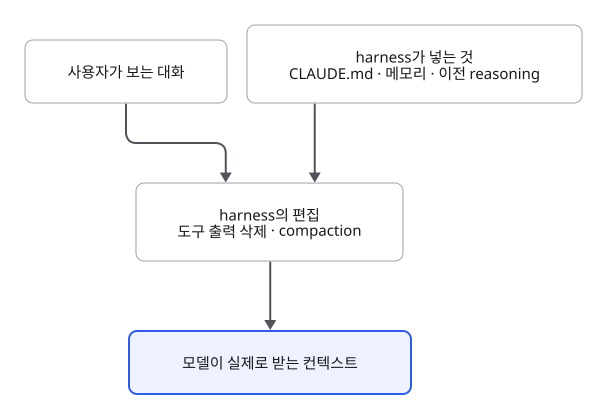

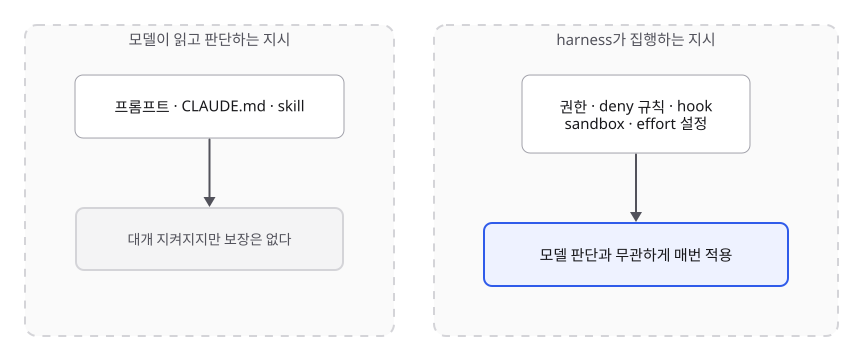

### 두 층에서 나오는 원칙

| 층 | 동작 원리 | 실무에서 뜻하는 것 | 이어지는 원칙 |
| --- | --- | --- | --- |
| LLM | 모델에게 영향을 주는 것은 컨텍스트뿐 | 목표와 사실은 내가 넣어야 들어간다 | 1. 목표, 2. 맥락 |
| LLM | attention은 나눠 쓰는 자원, 길이에 비용 | 많이 넣는다고 좋지 않다 | 2. 맥락 |
| LLM | 결과 reward로 학습, LLM judge는 해킹될 수 있음 | 확인은 실행 가능한 신호로 | 3. 검증 |
| harness | 바깥 세계는 도구 결과로만 들어옴 | 관측 수단이 없으면 추측한다 | 4. 실행 수단 |
| harness | 컨텍스트는 누적되고 편집됨 | 초기 오해는 비싸지고, 대화 속 세부는 사라질 수 있다 | 1. 목표, 2. 맥락, 5. 묻기 vs 진행 |
| harness | 꼭 지킬 규칙은 harness가 집행 | 금지 사항은 프롬프트가 아니라 설정으로 | 3. 검증, 4. 실행 수단 |

## 원칙 1. 목표: 무엇을, 왜, 무엇이 완료인지

명시되지 않은 의도는 모델이 학습에서 익힌 흔한 의도로 채워집니다. 에이전트에서는 그 해석이 컨텍스트에 남아 이후 모든 호출의 조건이 됩니다.

### 메커니즘

**지시가 곧 과제 정의다.** zero-shot 사용은 과제를 글로 설명하는 것이고, instruction tuning은 모델이 그 설명을 따르도록 길렀습니다. 그래서 결과는 "어떻게 묻느냐"에 달려 있습니다. 라벨의 의미도 예시로 추론하게 하는 것보다 그냥 말해 주는 편이 모델에게 더 쉽습니다.

**빈칸은 prior로 채워진다.** 사용자 의도를 latent variable Z로 두면 모델의 출력은 다음처럼 해석할 수 있습니다. 모델이 이 합을 명시적으로 계산한다는 뜻은 아닙니다.

```latex
p(y \mid c) = \sum_{z} p(y \mid z, c) \, p(z \mid c)
```

- \(c\): 모델이 받은 컨텍스트(요청을 포함한 입력 전체)
- \(y\): 모델의 출력
- \(z\): 사용자의 의도가 될 수 있는 후보 하나
- \(p(z \mid c)\): 컨텍스트를 보고 의도가 \(z\)라고 볼 확률
- \(p(y \mid z, c)\): 의도가 \(z\)일 때 출력 \(y\)가 나올 확률
- \(\sum_{z}\): 가능한 모든 의도 후보에 대해 더한다는 뜻
{.symbols}

c가 Z를 충분히 좁히지 못하면 posterior p(z | c)가 prior p(z)에 가까워지고, 출력은 "평균적인 사용자"의 의도에 맞춰집니다. Fano's inequality는 이를 오류율의 하한으로 묶습니다.

```latex
P(\hat{Z} \ne Z) \ge \frac{H(Z \mid C) - 1}{\log_2 |Z|}
```

- \(Z\): 사용자의 실제 의도, \(C\): 컨텍스트
- \(\hat{Z}\): \(C\)만 보고 추정한 의도. \(P(\hat{Z} \ne Z)\)는 그 추정이 틀릴 확률입니다
- \(H(Z \mid C)\): 컨텍스트를 알고 나서도 남는 의도의 불확실성(조건부 entropy, 단위는 bit)
- \(|Z|\): 가능한 의도의 개수. \(\log_2 |Z|\)는 의도를 구분하는 데 필요한 최대 bit 수입니다
{.symbols}

C만 보고 Z를 추정하는 모든 estimator에 적용되는 하한입니다. 모델 성능과 무관하게, H(Z | C)를 낮추는 방법은 c에 의도 정보를 더 넣는 것뿐입니다. |Z|가 작으면 우변이 0 이하가 되어 의미가 없으므로, 의도 공간이 넓은 개방형 작업에서 특히 의미 있는 결과입니다.

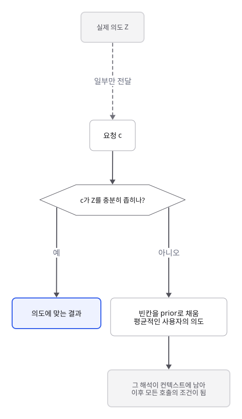

빈칸을 채우는 방향은 모델마다 다릅니다. 어떤 모델은 요청을 넓게 해석해 과하게 만들고, 어떤 모델은 보수적으로 해석해 최소한만 만듭니다. 원하는 범위가 있다면 그것도 빈칸으로 두지 말고 적어야 합니다.

**무엇을 정하고, 어떻게는 맡긴다.** instruction tuning 데이터의 지시는 과제와 선호를 담고 풀이 방법은 대개 담지 않습니다. reasoning 모델의 RL도 최종 결과에 reward를 줍니다. 이는 학습 단계에 관한 이야기지만, 지시를 쓰는 사람에게도 같은 교훈을 줍니다. **결과, 성공 기준, 허용되는 부작용은 분명히, 방법은 꼭 필요한 경우에만** 적습니다. 과장되거나 서로 모순되는 지시는 오히려 해롭습니다. 강조 표현을 쌓기보다 평범한 문장 하나로 분명히 적는 편이 낫습니다.

**첫 해석은 끝까지 남는다.** 모델이 쓴 토큰도 다음 호출의 조건이 됩니다. 잘못된 해석을 가장 싸게 고칠 수 있는 지점은 구현을 시작하기 전입니다. 큰 작업에서 계획을 먼저 받는 이유는 이것입니다. 계획은 모델의 생각을 끌어올리는 장치가 아니라, 사람이 해석을 검토할 수 있는 지점입니다. reasoning 모델은 이미 내부에서 추론하므로 "단계별로 생각하라" 같은 문구는 필요 없고, 생각의 깊이는 effort 같은 설정으로 조절합니다.

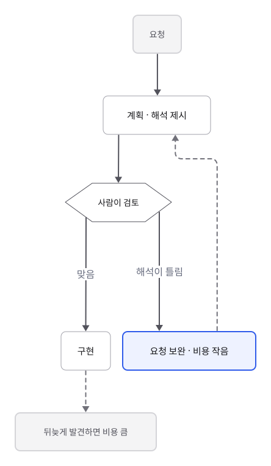

### 실무 적용

"무엇을"과 함께 "왜"와 "무엇이 완료인지"를 적습니다. 이유를 알면 모델이 범위와 트레이드오프를 스스로 판단할 수 있습니다.

| 모호한 요청 | 의도가 특정된 요청 |
| --- | --- |
| 로그인 버그 고쳐 줘 | 비밀번호에 특수문자가 있으면 로그인이 실패하는 버그를 고쳐 줘. 이번 배포에 넣어야 하니 변경 범위는 최소로 |
| 이 모듈 리팩터링해 줘 | 다음 분기에 결제 수단을 추가할 예정이니, PaymentProvider를 인터페이스로 분리해 확장 지점을 만들어 줘. 외부 API 시그니처는 유지 |
| 이 서비스에 캐시 붙여 줘 | 상품 조회 p95 latency를 200ms 아래로 낮추고 싶어. 먼저 원인 분석과 계획을 보여 주고, 내가 확인하면 구현해 |

- 결과와 제약(바꾸면 안 되는 것, 범위, 마감)은 분명히 적습니다. 풀이 순서는 꼭 지켜야 할 이유가 있을 때만 적습니다.
- 최소 수정이 아니라 완성도 있는 결과를 원하면 그렇게 말합니다. 엣지 케이스 처리, 이어지는 작업까지 포함할지도 범위의 일부입니다.
- 출력 형식이 중요하면 형식을 명시합니다.
- 정의가 미묘해서 말로 설명하기 어려우면 예시 몇 개를 붙입니다(few-shot). 예시는 형식과 구조, 접근 방식까지 강하게 끌어당기므로, 따라 하길 원하는 것만 담긴 예시를 고릅니다. 다만 예시로 모델의 근본 능력이 커지지는 않습니다.
- 큰 작업은 계획을 먼저 받고 검토한 뒤 진행시킵니다.

**점검 질문**: 이 요청을 처음 보는 동료가 읽어도 같은 결과물을 떠올릴까? 무엇이 되면 끝인지 적혀 있나?

## 원칙 2. 맥락: 모르는 것은 넣고, 관련 없는 것은 덜어낸다

c에 없는 정보는 출력에 나올 수 없고, 관련 없는 정보는 필요한 정보에 대한 attention을 희석합니다. 맥락은 부족해도, 넘쳐도 문제입니다.

### 메커니즘

**부족: weight에 없는 사실은 컨텍스트로만 들어온다.** RAG가 나온 이유가 이것입니다. 범용 모델은 기업의 내부 정보를 학습 데이터에서 본 적이 없으니, 관련 문서를 찾아 컨텍스트에 넣어 주고 질문과 함께 보게 합니다. 이 원리를 일반화한 것이 data processing inequality입니다. X를 내 상황에 대한 사실, Y를 출력이라 하면, Y는 (C, θ)만의 함수이므로 X → (C, θ) → Y가 Markov chain을 이루고 다음이 성립합니다.

```latex
I(Y; X) \le I(C, \theta; X)
```

- \(X\): 내 상황에 대한 사실, \(C\): 컨텍스트, \(\theta\): 모델의 weight, \(Y\): 출력
- \(I(Y; X)\): mutual information. \(Y\)를 보면 \(X\)에 대해 알 수 있는 정보의 양입니다
- \(I(C, \theta; X)\): 컨텍스트와 weight를 모두 보면 \(X\)에 대해 알 수 있는 정보의 양
{.symbols}

θ에는 일반적인 관행은 있어도 특정 저장소나 조직 고유의 사실은 없습니다. 그 정보가 c에도 없으면, 모델 성능과 무관하게 출력에 반영될 수 없습니다. 다만 에이전트는 도구로 저장소를 직접 읽을 수 있으므로, **사람이 넣어야 하는 것은 읽어서는 알 수 없는 정보**로 좁혀집니다.

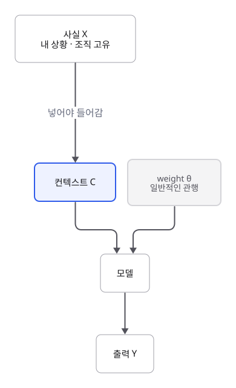

**과잉: attention은 나눠 쓰는 자원이다.** 관련 토큰의 점수를 s_r, 무관한 토큰 N개의 점수를 s_0라 하면, 단일 softmax head에서 관련 토큰의 weight는 다음과 같습니다.

```latex
a_r = \frac{e^{s_r}}{e^{s_r} + N e^{s_0}}
```

- \(a_r\): 관련 토큰이 받는 attention weight. 0과 1 사이 값입니다
- \(s_r\): 관련 토큰의 점수, \(s_0\): 무관한 토큰의 점수(모두 같다고 단순화)
- \(N\): 무관한 토큰의 개수
- \(e^{s}\): softmax가 점수를 양수로 바꾸는 지수 함수
{.symbols}

N이 커질수록 a_r은 작아집니다. 실제 모델은 여러 layer와 head로 날카로운 attention을 학습하므로 이 식은 경향을 보여 주는 단순화입니다. 실제로는 급격히 무너지기보다 서서히 나빠지며, 긴 컨텍스트의 중간에 놓인 정보를 특히 잘 놓칩니다.

**대화 속 정보는 harness가 편집한다.** 컨텍스트 창이 커져서 공간이 모자라는 일은 드물어졌지만, 긴 세션은 결국 compaction을 거칩니다. 요약이든 암호화된 항목이든 원래 대화를 그대로 보존하지는 않으므로, 대화 초반에 말한 세부 지시는 사라질 수 있습니다. 반면 CLAUDE.md 같은 파일은 compaction 뒤에도 다시 들어갑니다.

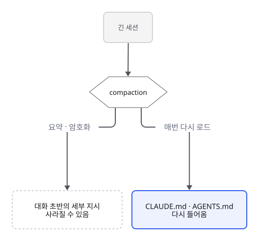

### 실무 적용

- 저장소를 읽어서는 알 수 없는 정보를 넣습니다. 설계 결정의 배경, 빌드와 테스트 명령, 오해를 부르는 코드에 대한 설명, 이미 시도해 실패한 접근과 그 이유, 결과물을 쓸 사람입니다. 파일 구조처럼 에이전트가 직접 읽을 수 있는 것은 적지 않습니다.
- 매번 필요한 맥락은 CLAUDE.md나 AGENTS.md처럼 항상 로드되는 파일에 둡니다. 짧게 유지하고(긴 내용은 다른 문서로 안내하는 목차 역할), 대화 중에 한 번 말한 제약에 기대지 않습니다.
- 큰 자료는 붙여 넣지 말고 위치만 알려 주어, 에이전트가 필요할 때 읽게 합니다. 코드는 구조가 뚜렷해 grep 같은 정확한 검색이 잘 맞습니다. 이는 원칙 4의 도구가 있어야 가능합니다.
- 긴 문서를 직접 넣어야 한다면 문서를 앞에, 질문과 지시를 끝에 둡니다.
- subagent는 병렬 작업, 로그처럼 시끄러운 출력을 걸러 내는 일, 독립 리뷰에 씁니다. 같은 일을 subagent에 넘긴다고 답이 더 좋아지지는 않고 토큰은 더 듭니다. 단일 에이전트로 충분하면 그대로 둡니다.
- 하나의 작업 단위는 한 세션에서 이어 가고, 주제가 바뀌면 새 세션을 엽니다. 이전 작업의 흔적은 다음 작업에서 관련 없는 맥락입니다.

**점검 질문**: 결과를 바꿀 만한, 저장소에 없는 정보가 빠지지 않았나? 관련 없는 자료를 습관적으로 붙이고 있지 않나?

## 원칙 3. 검증: 성공 기준을 정하고, 그 결과가 에이전트에게 돌아오게

모델의 자기 평가는 같은 분포에서 나온 또 하나의 예측입니다. 실행 가능한 외부 검증 신호가 컨텍스트로 돌아와야 오류 누적이 끊깁니다.

### 메커니즘

**오류 누적.** 단계별 성공 확률을 p라 하고, 단계가 독립이며 한 단계의 오류가 전체를 망친다고 가정하면 다음과 같습니다.

```latex
P(\text{success}) = p^{n}, \qquad 0.95^{20} \approx 0.36
```

- \(p\): 한 단계가 성공할 확률, \(n\): 단계 수
- 예: 단계마다 95% 성공해도 20단계를 거치면 전체 성공 확률은 약 36%입니다
{.symbols}

**검증 후 재시도.** 출력은 sampling이라 시도마다 달라집니다. 시도당 성공 확률을 q라 하고, 시도가 독립이며 verifier가 완벽하다고 가정하면 다음과 같습니다.

```latex
P(\text{success within } k) = 1 - (1 - q)^{k}, \qquad 1 - 0.5^{5} \approx 0.97
```

- \(q\): 한 번 시도해 성공할 확률, \(k\): 시도 횟수
- \((1 - q)^{k}\): \(k\)번 모두 실패할 확률. 1에서 빼면 한 번이라도 성공할 확률입니다
- 예: 시도당 성공 확률이 50%여도 5번 시도하면 약 97%입니다
{.symbols}

같은 모델의 시도는 오류가 서로 상관되어 있어, 실제 이득은 이보다 작습니다. 통과 여부만이 아니라 실패 원인(stack trace, diff, 기대값과 실제값)이 함께 돌아와야 다음 시도의 분포가 실제로 바뀝니다.

**자기 평가의 한계.** 자기 평가도 (C, θ)의 함수이므로, data processing inequality에 의해 c에 없던 정보를 만들지 못합니다. 재검토로 실수를 잡는 효과는 있지만, 누락된 사실은 외부 관측으로만 들어옵니다. 같은 모델이라도 작업 과정을 보지 않은 새 컨텍스트에서 검토하면 앞선 추론에 끌려가지 않으므로 더 독립적인 검토가 됩니다. LLM judge는 유연하지만 판정이 흔들릴 수 있고, 학습에서는 형식과 문체에 속아 reward hacking이 생길 수 있습니다.

**검증 기준이 곧 성공의 정의다.** reward design을 대충 하면 학습이 엉뚱한 방향으로 갑니다. 에이전트 루프에도 같은 구조가 있습니다. 에이전트는 검증이 통과할 때까지 반복하므로, 검증이 목표의 일부만 재면 그 일부만 맞춘 결과로 수렴할 수 있습니다. 실제로 모델이 테스트를 고치거나 특정 입력에만 맞는 답을 하드코딩해 통과시키는 사례가 보고되어 있고, 프롬프트로 금지하면 줄어들지만 사라지지는 않습니다.

**제어 관점.** 오차를 e, 단계마다 새로 생기는 오차를 δ, 피드백으로 보정하는 비율을 α라 하면 다음과 같습니다.

```latex
\text{open: } e_{t+1} = e_t + \delta_t \qquad \text{closed: } e_{t+1} = (1 - \alpha)\, e_t + \delta_t
```

- \(e_t\): \(t\)번째 단계의 오차
- \(\delta_t\): 그 단계에서 새로 생긴 오차
- \(\alpha\): 피드백으로 오차를 줄이는 비율. 0이면 보정이 없고, 1이면 한 번에 모두 보정합니다
{.symbols}

open-loop에서 오차는 δ가 편향이면 선형으로, 무작위면 √t로 커집니다. closed-loop는 0 < α < 2이고 δ가 bounded이면 오차도 bounded로 유지됩니다. 검증 결과를 컨텍스트에 돌려주는 것이 피드백 경로입니다.

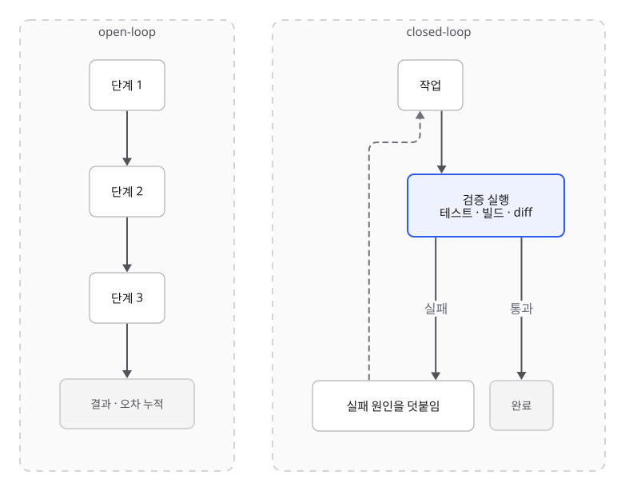

### 실무 적용

| 검증 없는 요청 | 검증이 포함된 요청 |
| --- | --- |
| 로그인 버그 고쳐 줘 | 재현 테스트를 먼저 작성해 실패를 확인하고, 수정 후 그 테스트와 기존 test suite가 통과하는지 실행해 |
| 이 쿼리 최적화해 줘 | 수정 전후의 execution plan과 실행 시간을 비교하고, 결과 행이 동일한지 확인해 |
| 보고서 요약해 줘 | 요약에 나온 수치를 원문과 대조해 불일치를 표로 보고해 |

- 가능하면 프로그램으로 판정하는 검증(테스트, type check, lint, 빌드, diff, 수치 대조)을 우선합니다.
- "완료했다"는 말 대신, 실행한 명령과 그 출력을 증거로 보고하게 합니다.
- 리뷰는 작업을 하지 않은 새 세션이나 별도 reviewer에게 맡깁니다. LLM 리뷰에는 "괜찮아 보이나?" 대신 구체적인 기준과 대조할 원문을 함께 줍니다.
- 검증이 목표 전체를 재는지 확인합니다. 테스트 수정 금지는 프롬프트에 적는 것에 그치지 말고, 테스트 파일 쓰기를 막는 권한 설정이나 hook으로 강제합니다.

**점검 질문**: 성공을 무엇으로 판정하나? 그 판정을 에이전트가 직접 실행하고, 실패 원인까지 볼 수 있나? 그 판정을 통과하면 정말 목표를 이룬 것인가?

## 원칙 4. 실행 수단: 보고 확인할 도구와 권한

모델은 컨텍스트에 들어온 관측으로만 바깥 상태를 알 수 있고, 그 관측을 만드는 것은 harness가 실행하는 도구입니다. 도구는 원칙 2(맥락 수집)와 원칙 3(검증)을 에이전트가 스스로 수행하기 위한 전제입니다.

### 메커니즘

**모델의 state에는 바깥 세계가 없다.** MDP로 보면 LLM의 state는 프롬프트와 지금까지 생성한 토큰뿐입니다. 저장소의 실제 코드, 서버 로그, 패키지의 최신 버전은 이 state 어디에도 없습니다. 도구 결과가 컨텍스트에 덧붙어야 비로소 state의 일부가 됩니다.

**Partial observability.** 에이전트는 POMDP로 모델링할 수 있습니다. 환경 state s는 직접 관측되지 않고, action a 이후 들어온 observation o(사용자 입력, 도구 결과)로 belief가 갱신됩니다.

```latex
b'(s') \propto p(o \mid s', a) \sum_{s} p(s' \mid s, a) \, b(s)
```

- \(s\): 지금 환경의 실제 state(직접 보이지 않음), \(s'\): 행동한 뒤의 다음 state
- \(a\): 에이전트의 action, \(o\): 그 뒤에 들어온 observation(도구 결과 등)
- \(b(s)\): 지금 state가 \(s\)라고 믿는 확률(belief). \(b'(s')\)는 갱신된 belief입니다
- \(p(s' \mid s, a)\): \(s\)에서 \(a\)를 했을 때 \(s'\)로 갈 확률(transition model)
- \(p(o \mid s', a)\): state가 \(s'\)일 때 \(o\)를 관측할 확률(observation model)
- \(\propto\): 비례한다는 뜻. 합이 1이 되도록 나누는 과정을 생략했습니다
{.symbols}

observation 항 p(o | s', a)가 없으면 belief는 transition model만으로 굴러가고, 실제 state와의 오차를 줄일 수단이 없습니다. 에이전트에서 transition model은 θ에 담긴 일반적인 예상이므로, 관측이 없는 에이전트는 "보통 이렇게 되어 있을 것"을 전제로 행동합니다.

**읽기는 정보를 모으는 행동이다.** 당장 최선은 아니어도 정보를 모아 이후 결정을 낫게 하는 행동을 exploration이라고 부릅니다. 에이전트에게 파일 읽기와 검색은 비용이 작은 exploration입니다. 제어 이론의 용어로 말하면, 읽기 도구는 sensor이고 쓰기와 실행 도구는 actuator입니다. sensor가 없으면 observable하지 않고, actuator가 없으면 바꾸거나 검증할 수 없습니다.

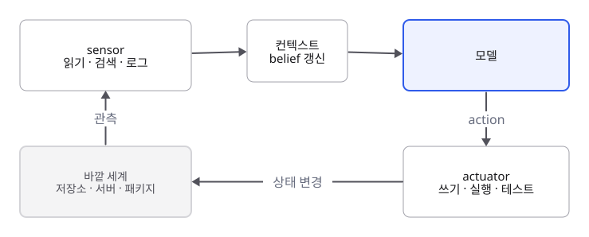

**읽은 내용도 입력이다.** 도구로 읽어 들인 웹 페이지, 이슈, 문서는 모두 컨텍스트에 들어가 모델의 다음 판단에 영향을 줍니다. 그 안에 지시처럼 쓰인 문장이 있으면 모델이 따를 수 있습니다(prompt injection). 관측을 넓힐수록 이 경로도 넓어집니다.

### 실무 적용

| 작업 | 필요한 도구 | 없을 때 |
| --- | --- | --- |
| 버그 수정 | 저장소 읽기와 검색, 테스트 실행 | 코드를 추측해 수정하고 검증하지 못함 |
| 의존성 업그레이드 | 문서와 package registry 조회, 빌드 실행 | 학습 시점의 오래된 API로 작성함 |
| 장애 분석 | 로그와 메트릭 조회 | 일반적인 원인 목록을 나열함 |
| 사내 문서 기반 답변 | 문서 검색(구조가 약한 문서는 semantic search가 도움) | 그럴듯한 일반론으로 답함 |

- 검색 도구는 자료에 맞게 고릅니다. 구조가 뚜렷한 코드에는 grep 같은 정확한 검색이, 그런 방식이 어려운 자료에는 semantic search가 맞고, 둘을 섞을 수도 있습니다.
- 권한은 harness 설정으로 경계를 긋습니다. 작업 공간 안의 읽기와 되돌릴 수 있는 쓰기는 넓게 허용하고, 작업 공간 밖의 변경, 네트워크, 되돌리기 어려운 동작(배포, 삭제, 외부 발송)은 좁게 둡니다.
- 읽기도 무제한은 아닙니다. `.env`나 인증 정보 같은 파일은 deny 규칙으로 읽기를 막고, 신뢰할 수 없는 내용을 읽는 작업은 네트워크를 제한한 환경에서 돌립니다.
- 되돌릴 수 있게 만들어 둡니다. 깨끗한 브랜치나 체크포인트에서 시작하면 더 많은 작업을 묻지 않고 맡길 수 있습니다. 이는 원칙 5의 판단과 맞물립니다.

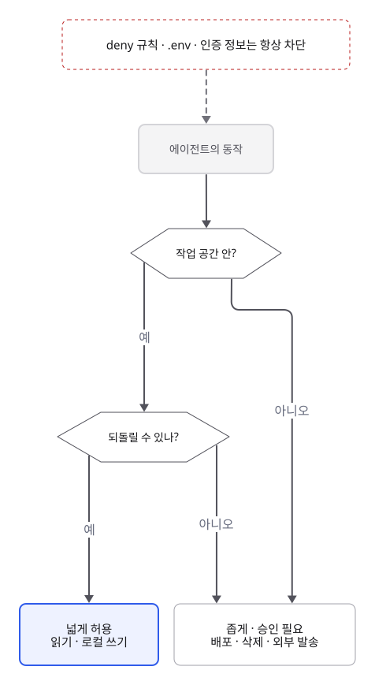

**점검 질문**: 맥락 수집과 검증에 필요한 도구가 연결되어 있나? 없다면 그 관측은 누가 대신 제공하나? 막아야 할 읽기와 쓰기는 설정으로 막혀 있나?

## 원칙 5. 묻기 vs 진행: 빈칸을 언제 묻고, 언제 가정하고 진행하나

남은 빈칸은 도구로 먼저 채웁니다. 그래도 남으면 복구 비용에 따라, 가정을 명시하고 진행하거나 멈추고 묻습니다.

### 메커니즘

**앞선 결정은 뒤에 파급된다.** sequential decision-making에서는 지금 최선인 선택이 나중에도 최선이라는 보장이 없으므로, 이후의 결과까지 생각해야 합니다. 에이전트에서 잘못된 가정은 컨텍스트에 남아 이후 호출의 조건이 되므로, 복구 비용은 진행할수록 커집니다.

**Value of Information.** 의사결정 이론의 Value of Information(VoI)을 단순화하면 다음 규칙이 됩니다.

```latex
P(\text{wrong}) \cdot C_{\text{recover}} > C_{\text{ask}} \;\Rightarrow\; \text{ask}
```

- \(P(\text{wrong})\): 가정이 틀릴 확률
- \(C_{\text{recover}}\): 틀렸을 때 되돌리는 비용
- \(C_{\text{ask}}\): 묻는 비용(사람의 시간, 작업이 멈추는 것)
- \(\Rightarrow\): 왼쪽 조건이 맞으면 오른쪽을 한다는 뜻. 틀렸을 때의 기대 비용이 묻는 비용보다 크면 묻습니다
{.symbols}

정확한 계산이 아니라 판단 방향을 잡는 어림 규칙입니다. 이 규칙에서 네 가지가 나옵니다.

- 도구 조회는 질문보다 싼 비용으로 P(wrong)을 낮추므로 먼저 합니다. 원칙 4에서 본 exploration입니다.
- 되돌리기 쉬운 작업(로컬 변경, 초안, 읽기 전용 조회)은 C_recover가 작아서, 가정을 명시하고 진행합니다.
- 되돌리기 어려운 작업(배포, 데이터 삭제, 외부 발송, 대규모 재작업)은 P(wrong)이 작아도 묻습니다.
- 물어야 할 때도 C_ask를 줄일 수 있습니다. 이미 할 수 있는 일은 먼저 끝내고, 사람이 바로 판단할 수 있는 구체적인 결과물(계획, diff, 초안)과 함께 묻습니다. 막연한 질문보다 검토할 결과물이 있는 질문이 답하기 쉽고 정확합니다.

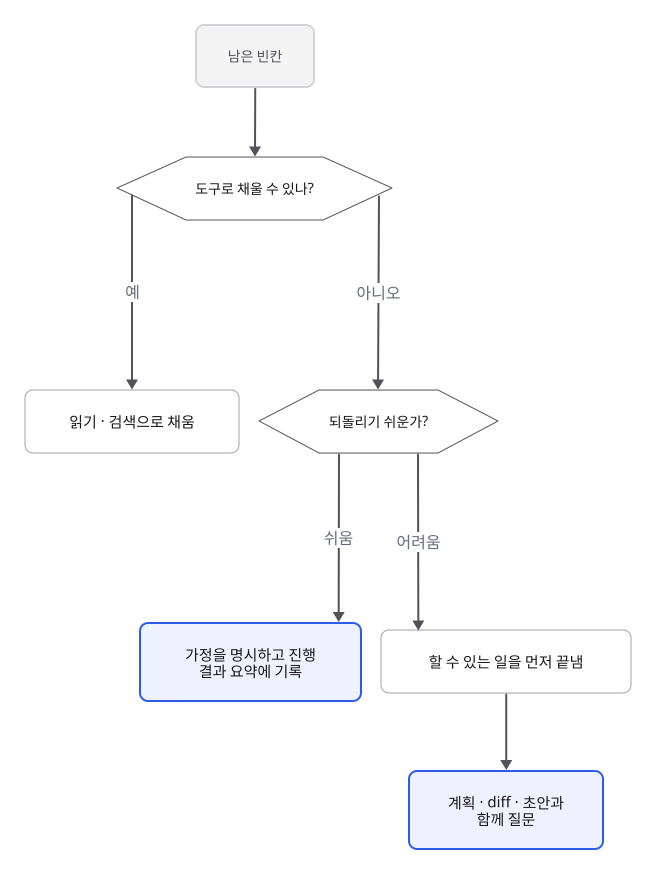

### 실무 적용

이 기준을 지시나 CLAUDE.md에 명시합니다. 예를 들면 "되돌리기 어려운 결정은 먼저 확인하고, 나머지는 가정을 결과 요약에 적고 진행해. 확인이 필요하면 할 수 있는 작업을 마친 뒤 검토할 결과와 함께 물어봐"입니다. 가정을 기록해 두면 리뷰어가 틀린 가정을 한눈에 찾을 수 있습니다. 반드시 멈춰야 하는 동작은 지시에만 두지 말고 권한 설정으로 승인을 요구하게 합니다.

**점검 질문**: 남은 빈칸을 도구로 채울 수 있나? 없다면 잘못 가정했을 때 되돌리는 데 얼마나 드나? 묻는다면 무엇을 먼저 만들어 두고 물을 것인가?

## 한눈에 보기

| 원칙 | 점검 질문 | 이유 | 바탕이 되는 원리 |
| --- | --- | --- | --- |
| 1. 목표 | 무엇을, 왜, 무엇이 완료인지 모호하지 않은가? | 모델에게 영향을 주는 것은 컨텍스트뿐이고, 빈칸은 흔한 의도로 채워지며, 첫 해석이 끝까지 참조된다 | (LLM) instruction tuning, 결과 기반 reward, Fano's inequality · (harness) 컨텍스트 누적 |
| 2. 맥락 | 저장소에 없는 정보가 빠지지 않았나? 관련 없는 정보가 넘치지 않나? | 컨텍스트에 없으면 모델에게 없는 정보이고, attention은 나눠 쓰는 자원이다 | (LLM) data processing inequality, attention, context rot · (harness) 항상 로드되는 파일, compaction |
| 3. 검증 | 성공을 무엇으로 확인하고, 그 결과가 에이전트에게 돌아오나? | 자기 채점은 새 정보를 못 만들고, 검증이 성공을 정의한다 | (LLM) verifiable reward, reward hacking · (harness) closed-loop 피드백, hook과 권한으로 강제 |
| 4. 실행 수단 | 맥락 수집과 검증에 필요한 도구, 권한이 있나? | 바깥 세계는 harness가 실행한 도구 결과로만 들어온다 | (harness) 도구 실행, POMDP, 권한 경계, prompt injection |
| 5. 묻기 vs 진행 | 도구로 못 채운 빈칸은 되돌리기 쉬운가? | 잘못된 가정은 쌓이고, 되돌리기 어려울수록 대가가 크다 | (harness) sequential decision-making, 승인 설정 · Value of Information |

### 점검 순서

다섯 원칙은 따로 노는 것이 아니라 순서가 있습니다.

1. **목표**를 먼저 정합니다. 무엇이 필요한 맥락이고 무엇이 성공인지는 목표가 정해져야 알 수 있습니다.
2. **실행 수단**을 확인합니다. 도구가 있으면 맥락과 검증 중 상당 부분을 에이전트가 직접 채웁니다.
3. **맥락**과 **검증**에서 도구로 못 채운 부분을 사람이 채웁니다.
4. 그래도 남은 빈칸은 **묻기 vs 진행**으로 판단합니다.

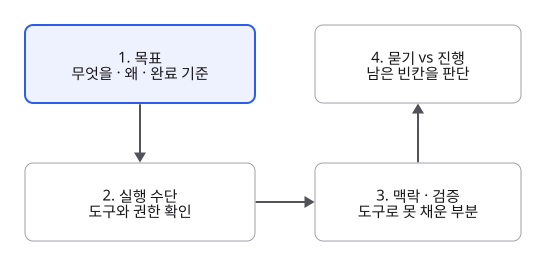

## 스스로 확인하기

아래 질문에 자기 말로 답할 수 있으면 이 문서의 내용을 이해한 것입니다. 막히는 질문은 1부, 2부나 해당 원칙의 "메커니즘"을 다시 읽어 보세요.

- [ ] LLM에게 영향을 줄 수 있는 것은 무엇인가? 예시를 넣으면 모델의 weight가 바뀌나?
- [ ] 모델이 받는 컨텍스트는 사용자가 보는 대화와 어떻게 다를 수 있나?
- [ ] 프롬프트에 적은 금지 사항과 권한 설정으로 막은 금지 사항은 무엇이 다른가?
- [ ] 요청이 모호하면 모델은 빈칸을 무엇으로 채우나? 에이전트에서는 왜 그 영향이 더 커지나?
- [ ] 지시에 "무엇을"은 분명히 쓰되 "어떻게"는 꼭 필요할 때만 쓰라는 이유는?
- [ ] 에이전트가 저장소를 읽을 수 있을 때, 사람이 컨텍스트로 넣어야 하는 정보는 무엇인가?
- [ ] 관련 없는 자료를 많이 붙이면 왜 결과가 나빠질 수 있나?
- [ ] 모델이 스스로 "잘 됐다"고 확인하는 것보다 테스트 결과나 새 세션의 리뷰가 더 믿을 만한 이유는?
- [ ] 테스트가 목표의 일부만 확인하면 에이전트의 결과는 어떻게 될까?
- [ ] 빈칸이 있을 때 묻지 않고 진행해도 되는 경우와 반드시 물어야 하는 경우를 가르는 기준은? 물을 때는 무엇을 함께 보여 주는 것이 좋은가?

## 참고 자료

- [Stanford CS229 Machine Learning, Spring 2026 (강의 영상)](https://youtube.com/playlist?list=PLaqpC4kq8Gpw&si=dtbWkWGUmREFQkqB)
- [Liu et al., 2023, Lost in the Middle: How Language Models Use Long Contexts](https://arxiv.org/abs/2307.03172)
- [Anthropic, Building effective agents](https://www.anthropic.com/engineering/building-effective-agents)
- [Anthropic, Effective context engineering for AI agents](https://www.anthropic.com/engineering/effective-context-engineering-for-ai-agents)
- [Claude Code, Best practices](https://code.claude.com/docs/en/best-practices)
- [Claude Code, How Claude Code works](https://code.claude.com/docs/en/how-claude-code-works)
- [OpenAI, Unrolling the Codex agent loop](https://openai.com/index/unrolling-the-codex-agent-loop/)
- [OpenAI, GPT-5.5 prompting guide](https://developers.openai.com/api/docs/guides/gpt-5.5)
- [OpenAI, Harness engineering](https://openai.com/index/harness-engineering/)
